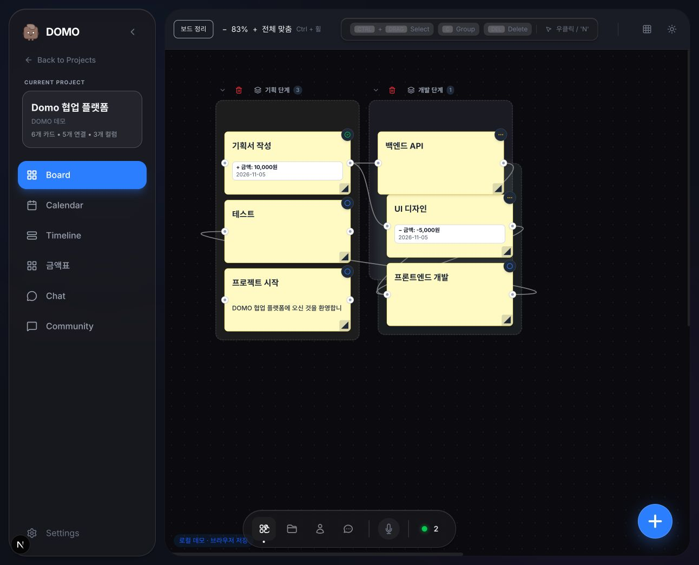

# DOMO — 로컬 프로젝트 워크스페이스

카드와 그룹을 캔버스에 배치하고 연결선으로 작업 흐름을 정리합니다.
현재 집중 개발 중인 버전은 **개인용 로컬 데모 / Windows·Linux 데스크톱 앱**입니다.



## 주요 기능

- 워크스페이스·프로젝트·보드, 카드 상세 편집과 우클릭 삭제
- 그룹 생성·이동·접기·삭제(카드 유지), 보드 자동 정리
- 카드 우측 하단 드래그 크기 조절, 상세 화면에서 정확한 크기 지정
- 실선·점선·화살표선, 직선·곡선 연결
- Ctrl+휠 확대·축소(25–200%), 배율 버튼, 100% 복원, 전체 맞춤
- 밝기(화이트/다크/시스템)와 강조 색상을 독립적으로 선택하는 테마
- 카드 금액 옵션 `+`, `-`, `총합`, `평균`, 연결 기반 계산·날짜별 금액표·Excel 내보내기
- 달력·타임라인·채팅·게시판 화면과 로컬 목 데이터
- JSON 백업 내보내기/가져오기, 데스크톱 날짜별 자동 백업

로컬 모드는 실제 다중 사용자 협업이 아닙니다. 서버 동기화·음성·파일 기능 전체가
오프라인으로 동작한다고 보장하지 않습니다. **금액과 카드 크기 저장은 현재 목 모드 전용**입니다.

## 브라우저 로컬 데모

Node.js 22와 npm을 준비합니다.

```bash
git clone https://github.com/hangjin01/domo_frontend.git
cd domo_frontend
npm ci
cp .env.example .env.local
```

예제의 기본값은 실제 API 모드이므로 `.env.local`을 다음과 같이 설정합니다.

```dotenv
API_URL=http://localhost:9000
NEXT_PUBLIC_API_URL=http://localhost:9000
NEXT_PUBLIC_USE_MOCK=true
```

```bash
npm run dev -- --hostname 127.0.0.1
```

[로컬 로그인](http://127.0.0.1:3000/login): **test@gmail.com / 1234**

처음에는 데모 워크스페이스 1개와 샘플 프로젝트로 시작합니다.
데모 계정은 실제 계정 보안을 제공하지 않습니다.
데이터는 브라우저에 저장되며 `localhost`, `127.0.0.1`, 데스크톱 앱은 서로 다른 저장소입니다.
접속 주소를 일관되게 사용하고 중요한 데이터는 설정에서 백업하세요.

Windows PowerShell의 복사 명령은 `Copy-Item .env.example .env.local`입니다.
Fedora에서 공유 라이브러리 충돌이 있는 경우에만 명령 앞에 `env LD_LIBRARY_PATH=/usr/lib64`를 붙입니다.

## 데스크톱 빌드

Electron이 Next.js 서버를 함께 실행합니다. 빌드된 앱 사용 시 Node.js·Python·Docker를 별도로 켤 필요가 없습니다.

### Linux

```bash
npm ci
npm test
npm run desktop:prepare
npm run desktop:package -- --linux AppImage
npm run desktop:install-linux
```

앱 메뉴에서 **DOMO**를 실행합니다. 결과물은 `dist-desktop/`에 생성됩니다.

- `linux-unpacked/domo`: 실행 폴더. 이동하면 바로가기를 재등록해야 합니다.
- `DOMO-0.1.0-linux-x86_64.AppImage`: 이동식 실행 파일.

### Windows

Windows에서 Node.js 22를 설치한 뒤 실행합니다.

```powershell
npm ci
npm test
npm run desktop:build
```

NSIS 설치 파일과 바탕화면/시작 메뉴 바로가기를 지원하도록 구성했습니다.
**Windows EXE 생성·실행은 아직 검증하지 않았습니다.** 네이티브 의존성 때문에 대상 OS에서 빌드하세요.

GitHub Actions → **Desktop packages** → **Run workflow**에서도 Windows/Linux 빌드가 가능합니다.
워크플로는 수동 실행이며 결과는 Actions artifacts에 보관합니다. 자동 Release 배포는 하지 않습니다.
실행 파일은 Git에 포함하지 않습니다. 상세 내용은 [데스크톱 안내](desktop/README.md)를 참고하세요.

## 실제 백엔드 연결

[domo_backend](https://github.com/hangjin01/domo_backend)를 별도로 실행하고
`NEXT_PUBLIC_USE_MOCK=false`로 변경한 뒤 프론트를 재시작합니다.

- HTTP: Next.js `/api/*` 프록시 → `API_URL`
- WebSocket: `NEXT_PUBLIC_API_URL`
- 데모 계정과 브라우저 데이터는 서버 DB에 자동 생성·이관되지 않습니다.
- 서버 권한·파일 접근·실시간 기능에는 추가 검증과 보강이 필요합니다. 운영 서비스로 바로 공개하지 마세요.

## 코드 구조

```text
src/app/                 Next.js 라우팅과 레이아웃
src/containers/          화면 조합·상태·API 연결 훅
src/views/               보드·카드·설정 UI
src/models/api/          실제 API / 목 API 경계
src/models/types/        공유 데이터 타입
src/models/utils/        보드 좌표·그룹·금액 계산
src/lib/                 테마·백업·Excel 생성
desktop/                 Electron 실행·백업·패키징
tests/                   Node 기반 회귀 테스트
docs/                    기능 설명과 화면 기록
```

주요 스택: Next.js 16.4.4, React 19.2.3, TypeScript 5, Tailwind CSS 4, Electron 45.2.1.
정확한 의존성 버전은 `package-lock.json`을 기준으로 합니다.

## 검증

```bash
npm test
npx tsc --noEmit
npm run build
```

2026-11-07 기준 테스트 6개 파일, TypeScript 검사, Linux 프로덕션 빌드·AppImage 패키징을 통과했습니다.
브라우저에서 배율 버튼·전체 맞춤·축소 상태 카드 크기 변경을 확인했습니다.
Ctrl+휠 수정키 조합은 자동 UI 도구로 직접 재현하지 못해 실제 앱에서 확인할 항목입니다.
모든 기능과 다중 사용자 환경을 검증했다는 의미는 아닙니다.

개발·검증을 마친 뒤 마지막에 데스크톱을 빌드합니다.
실행 중인 앱은 패키징 전에 종료하고 여러 빌드를 동시에 실행하지 않습니다.

## 문서와 데이터

- [금액 카드·계산·Excel](docs/08-card-money.md)
- [카드 크기·그룹 정렬](docs/09-card-size-and-group-layout.md)
- [보드 확대·축소 기록](docs/10-board-zoom-progress.md)
- [초기 데모 검증·화면 기록](docs/demo/README.md)
- [Windows/Linux 데스크톱 안내](desktop/README.md)

환경파일·API 키·개인 첨부파일·평문 백업·앱 저장소는 공개 저장소에 올리지 마세요.
브라우저 저장소 삭제나 OS 계정 손실에 대비해 외부 백업을 권장합니다.

원본 프로젝트: [DOMO-UNIV/domo_frontend](https://github.com/DOMO-UNIV/domo_frontend).
이 저장소는 개인 로컬 사용과 데스크톱 기능을 개발하는 포크입니다.
