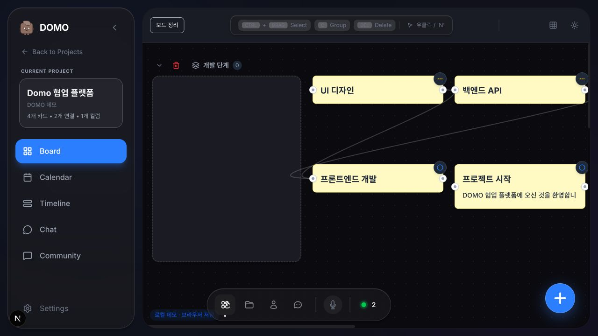

# DOMO 로컬 데모 점검 · 2026-11-03

> 아래는 11월 3일 당시 기록입니다. 이후 금액 카드·크기 조절·확대·축소와 Linux 앱 빌드가 추가되었습니다. 최신 상태는 [프로젝트 README](../../README.md)를 참고하세요. 아래 미커밋/미빌드 표기는 당시 상태입니다.

현재 사용자의 브라우저에 남아 있던 **카드 4개, 연결선 2개, 그룹 1개**를 기준으로 정리했습니다. 카드 내용·ID·연결·그룹 소속은 바꾸지 않았습니다. 삭제된 과거 카드를 재생성한 작업이 아닙니다.

## 재배치

로컬 목 모드 보드 상단의 **보드 정리** 버튼을 사용합니다. 그룹은 왼쪽, 자유 카드는 오른쪽 격자에 놓습니다. 좁은 화면에서는 그룹 아래로 내려갑니다. 중첩 그룹은 함께 이동하고 그룹 내부 카드의 상대좌표는 유지합니다.

정리 직전 보드는 브라우저 저장소 `domo:mock:v2:board-before-arrange`에 저장합니다. 다음 정리 때 덮어쓰는 단일 스냅샷이며 복원 UI/독립 파일 백업은 아직 없습니다. 실사용 백업을 대체하지 않습니다.

이 캡처의 데이터는 브라우저 저장 데이터이므로 Git clone만으로 같은 카드 상태가 복제되지는 않습니다. 신규 브라우저에서는 초기 샘플로 시작하며 정리 버튼을 사용할 수 있습니다.

## 확인 범위

| 항목 | 결과 / 한계 |
| --- | --- |
| 로그인 | 기존 데모 계정 로그인과 보드 진입 확인 |
| 보드 정리 | 4개 카드/2개 연결/1개 그룹 유지, 새로고침 후 위치 유지 확인 |
| 카드 상세 | 열기·설명·첨부 0개·댓글·설정 항목 표시, Esc 닫기 확인 |
| 달력 | 2026년 11월 화면 확인. 현재 카드에 일정이 없어 일정 표시/드래그는 미검증 |
| 타임라인 | 카드 4개 표시 확인. 일정·담당자 없는 상태이며 날짜 변경 미검증 |
| 채팅 | 로컬 전용 안내와 입력 화면 확인. 전송은 기존 자동 테스트 범위이며 이번 UI에서는 미실행 |
| 게시판 | 기존 글 2개 목록 표시 확인. 이번 UI에서는 글 생성/삭제 미실행 |
| 설정 | 퍼플 화이트/다크 전환 확인 후 기존 시스템/기본으로 복원 |
| 자동 검사 | TypeScript 검사, 테스트 3개 파일 통과. 테마·목 API·카드 상세 및 정리 위치/원본 불변 회귀 검사 포함 |
| 드래그 | 자동 조작 중 이동 상태가 예상대로 종료되지 않는 현상 관찰. 새로고침 후 정리 버튼으로 배치했으며 드래그 전체 정상 판정은 보류 |
| 기타 | 파일 업로드·음성·실제 서버 동기화·권한·모든 파괴적 동작은 이번 UI 검증 대상에서 제외 |

## 화면 기록

브라우저 실제 화면을 수정 없이 저장했습니다. 초기 화면과 빈 상태도 포함하며, 준비 중인 기능을 완료된 것으로 표현하지 않습니다.

1. [정리 전](screenshots/01-before.png)
2. [정리 후](screenshots/02-board-arranged.png)
3. [카드 상세](screenshots/03-card-detail.png)
4. [달력](screenshots/04-calendar.png)
5. [타임라인](screenshots/05-timeline.png)
6. [채팅](screenshots/06-chat.png)
7. [게시판](screenshots/07-community.png)
8. [퍼플 화이트](screenshots/08-purple-light.png)
9. [퍼플 다크](screenshots/09-purple-dark.png)

## Git 업로드 전

- 이 폴더는 frontend 저장소 안에 있어 함께 버전 관리할 수 있습니다. 아직 커밋·푸시하지 않았습니다.
- `.env.local`은 현재 ignore됩니다. 실제 비밀키·토큰·개인 첨부파일·브라우저 저장소는 올리지 않습니다.
- 캡처에는 데모 프로젝트/사용자 표시가 있습니다. 공개 전 직접 검토하세요.
- 기존 미커밋 변경이 많으므로 전체 변경을 일괄 stage하지 말고 논리 단위로 검토합니다.

## 데스크톱 실사용 전 필요한 작업

현재는 목 모드 데모이지 안정적인 개인 데이터 앱이 아닙니다. 기존 데이터 내보내기/가져오기, 파일 백업·복원, 앱 업데이트와 독립된 저장 경로를 먼저 갖춰야 합니다. Electron으로 Next 실행 환경을 함께 묶고 Linux 배포 파일로 만들 수 있으나 이번 작업에서 실행 파일을 빌드한 것은 아닙니다. 개발용 저장소와 실사용 저장소도 분리해야 합니다.
